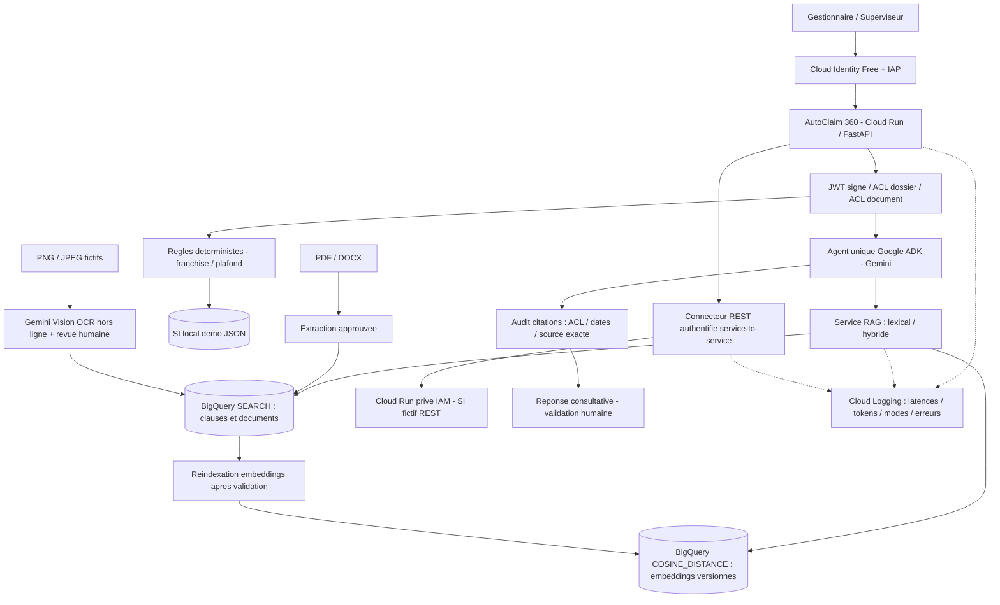

# AutoClaim 360 — Architecture V3 (mise à jour)

## Principes

Le projet est une démonstration fictive d'architecture **Google ADK / Gemini sur Cloud Run**, et **non** un agent enregistré dans Gemini Enterprise ou connecté à Google Workspace. Les profils métier sont dérivés des emails vérifiés par IAP ; la résolution des groupes Workspace reste hors périmètre.

### Flux RAG

1. IAP valide l'identité ; FastAPI vérifie le JWT signé, puis résout le rôle métier côté serveur.
2. L'accès au dossier est contrôlé avant BigQuery, ADK ou le connecteur SI.
3. Les CG exigées par la préanalyse sont retrouvées **par citation exacte** dans la table lexicale ; la proximité vectorielle ne peut pas remplacer une preuve contractuelle obligatoire.
4. Le moteur documentaire cherche soit par `SEARCH` (défaut), soit par `COSINE_DISTANCE` (sémantique), soit par fusion **RRF** de leurs classements (hybride). Les restrictions rôle / garantie / date sont appliquées **dans les requêtes BigQuery**, avant le classement.
5. Les références effectivement produites par Gemini sont réconciliées avec les sources autorisées. Une citation inconnue ou interdite bloque la réponse.
6. La règle de calcul et la décision humaine ne sont pas déléguées au modèle.

### Table sémantique dédiée

- `autoclaim_mvp.contract_embeddings_demo` : `ARRAY<FLOAT64>` de 768 dimensions (Gemini Embedding 001), `embedding_model`, `embedding_dimensions`, `content_sha256`, métadonnées source et ACL.
- `COSINE_DISTANCE` calcule une distance exacte sur le petit corpus *après filtrage SQL des ACL*. Pas d'index vectoriel créé pour 11/12 passages. Lorsque le volume augmente, étudier `VECTOR_SEARCH` et l'index vectoriel avec préfiltrage et protections de sécurité appropriées.
- Réindexer après chaque modification documentaire ; un vecteur périmé ne vaut pas vérification d'un document mis à jour.

### SI REST

- Deux services Cloud Run distincts : portail/agent et microservice SI fictif.
- Le service SI est accessible **uniquement aux identités disposant de `roles/run.invoker`**, sans `allUsers` ni authentification IAP côté SI (appel machine à machine).
- Le connecteur utilise un **jeton d'identité Google** émis pour l'URL du service cible, avec timeout, refus des redirections, contrôle du schéma de réponse et comparaison avec le dossier local déjà autorisé.
- Par défaut, `AUTOCLAIM_SI_MODE=local` : aucun appel REST. `rest` active une **vérification de cohérence**, pas encore le remplacement transactionnel du SI historique.
- Déployer le SI avec `--ingress=all --no-allow-unauthenticated` pour ce MVP. L'ingress `internal` demande une configuration réseau supplémentaire pour les appels d'un autre Cloud Run. L'accès reste restreint par IAM.

### Vision / OCR

- Un fichier PNG fictif a été analysé par Gemini Vision, revu humainement, approuvé, puis **indexé** sur les deux tables de démonstration.
- `--execute` lance l'OCR Gemini et crée un fichier en attente ; `--approve` fait entrer l'extrait révisé dans les données versionnées et leur manifest documentaire.
- Aucune prétention d'exactitude probante ou de validation de facture originale. Une photo interprétée par Gemini est une **extraction à vérifier**, pas une preuve suffisante pour l'indemnisation.

### Observabilité et évaluation

- Journaux structurés : `http_request`, `retrieval_search`, `citation_audit`, `llm_call`, `model_usage`, `si_connector`, `coverage_review`.
- Pas de prompt, contenu de document, email, numéro de dossier ou jeton dans les nouveaux événements métier.
- `data/retrieval_golden.json` : 15 requêtes (dont OCR positif, OCR hors période et OCR hors garantie), sources attendues/interdites, comparaison Hit@5 et MRR@5.
- `data/expected_cases.json` : 8 cas pour valider la logique métier déterministe.
- Les tokens sont des observations techniques. Les euros ne peuvent être estimés qu'avec une grille tarifaire actualisée ; la facture Cloud Billing reste la référence.

### Limites explicites

- Pas de synchronisation Workspace, de publication Gemini Enterprise ni de preuve de tenue de charge à 400 utilisateurs.
- RAG **hybride activé pour la démonstration** après benchmark initial. Le code conserve le mode lexical par défaut pour un nouveau déploiement et un repli explicite en cas de panne sémantique.
- Pas d'automatisation d'indemnisation, de paiement, de refus ni de conclusion juridique.
- Pas de stockage de sessions ADK partagées ; les six derniers messages sont fournis par le navigateur et traités comme non fiables.
- Test de conformité et de fuite documentaire nécessaire avant tout usage réel.

## État de validation — V3 (novembre 2026)

- **Implémenté et essayé sur GCP :** Cloud Identity Free / IAP, API et interface Cloud Run, agent ADK sur Vertex AI, BigQuery lexical/hybride (12 passages), API REST fictive protégée par IAM, Cloud Logging et tokens, OCR du PNG de démonstration approuvé et consultable via une API contrôlant le dossier et le document.
- **Résultats de benchmark connus avant extension du jeu de test :** 12 requêtes, 10 positives ; hybride Hit@5=1,000 et MRR@5=1,000, 0 citation interdite. Lexical MRR@5=0,883 après intégration du PNG. Ces résultats sont exploratoires et ne démontrent pas une performance sur grand corpus.
- **Extension du benchmark :** Q13 vérifie la source OCR `IMG-01` ; Q14 refuse l'OCR hors période et Q15 hors garantie. Le nouveau benchmark GCP doit être exécuté et son résultat archivé avant la publication V3.
- **Non testé / hors périmètre :** publication dans Gemini Enterprise, intégration native Google Workspace, réelle charge 400 utilisateurs, OCR de manuscrits difficiles, sécurisation de données personnelles de production, exactitude juridique, origine d'un original signé.

### Matrice de confiance et de provenance

| Donnée | Source de vérité | Contrôle | Utilisation |
|---|---|---|---|
| Pièces reçues, contrat, sinistre | SI fictif / vérification REST | Cohérence SI, ACL dossier, authentification IAP | Faits métier, pas un PDF généraliste |
| Clauses générales | BigQuery documentaire | ACL + date + citation exacte | Fondement documentaire de préanalyse |
| CP et avenants | Enregistrements structurés du SI fictif | Vérification du dossier et validité | Calculs déterministes, **pas un contrat signé** |
| Documents PDF / DOCX | Corpus de démonstration | Extraction, version, ACL documentaire | Guide et procédure ; pas source de faits SI hors contexte |
| Constat visuel PNG | Gemini Vision après revue humaine | SHA-256 du fichier source et approbation opérateur | Observation **non certifiée**, jamais décision automatique |

### Décisions d'architecture et limites

1. Un seul agent ADK, avec outils métier sécurisés ; le multi-agents ne justifie pas encore sa complexité.
2. BigQuery `SEARCH` et `COSINE_DISTANCE` sur les petits volumes, fusion RRF et filtrage ACL/date/garantie **avant classement**. Un index vectoriel et les stratégies de scalabilité sont réservés aux volumes plus élevés.
3. Le connecteur REST assure actuellement **une vérification de cohérence** avec les données locales ; il ne remplace pas un SI transactionnel de référence.
4. La mémoire du chat est bornée dans le navigateur, et les tours sont non fiables ; les droits sont réappliqués côté serveur à chaque appel.
5. Une référence existante et autorisée ne prouve pas à elle seule que **l'affirmation sémantique** de l'agent est correcte. L'attribution des faits SI vs guides documentaires reste un point d'évaluation supplémentaire.
6. Les 400 utilisateurs du client sont un **objectif de dimensionnement cible**, pas une capacité testée. Exiger tests de charge, SLO, quota, coûts et revue sécurité avant production.
