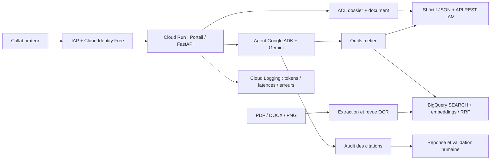

# AutoClaim 360 — Démonstration ciblée Architecte IA / Gemini Enterprise

**Durée : 6 minutes**. Public : responsable métier + architecte / sécurité + chef de projet. **Toutes les données sont fictives.** L'objectif est de montrer l'architecture et la qualité de l'intégration, pas d'imiter une interface Gemini Enterprise ou une application finalisée pour 400 personnes.

## En une phrase

> « J'ai conçu un agent ADK/Gemini sécurisé, intégré dans un portail métier fictif, qui confronte un SI REST aux clauses et à un corpus documentaire multimodal, trace les sources et laisse toute décision sensible à l'humain. »

## Déroulé démonstratif

| Temps | Manipulation | Ce que cela prouve |
|---|---|---|
| 0:00–0:45 | Ouvrir AutoClaim 360, compte superviseur et dossier `SIN-1001`. | Adoption et intégration de l'assistant au processus métier |
| 0:45–2:00 | Demander « Quels justificatifs et quel montant de franchise ? » puis ouvrir le PDF cité. | ADK + Gemini, BigQuery RAG, distinction SI / documents / calcul |
| 2:00–2:50 | Demander « Que dit le constat visuel ? Est-il signé ? » ; ouvrir le PNG source. | Gemini Vision à l'ingestion, revue humaine, citation auditée |
| 2:50–3:50 | Passer en compte gestionnaire : `SIN-1004` inaccessible, note de supervision non consultable. | IAP JWT, ACL dossier/document, aucun contournement via RAG |
| 3:50–4:40 | Montrer `/si-check` = `MATCH` et expliquer le token IAM Cloud Run → Cloud Run. | Connexion à une API métier indépendante, avec identité de service |
| 4:40–5:30 | Montrer logs `retrieval_search`, `si_connector`, `model_usage`, tests Pytest / GitHub Actions. | Exploitabilité, évaluation, observabilité et non-régression |
| 5:30–6:00 | Expliquer AS-IS vs cible Gemini Enterprise. | Maturité architecturale, périmètre et compromis |

## Schéma résumé — AS-IS

## Questions qui peuvent être posées

**Pourquoi pas un système multi-agents ?** Le cas se prête à un agent orchestrateur avec outils et services spécialisés. Un multi-agents ajouterait de la latence, de la complexité et des surfaces d'erreur sans bénéfice mesuré ici.

**Pourquoi BigQuery plutôt que Vertex AI RAG Engine ?** Existant et contrôlable pour un petit corpus ; `SEARCH` + `COSINE_DISTANCE` + ACL SQL + citations exactes, instrumentés et benchmarkés. RAG Engine est une option à évaluer selon volumétrie, parsing, latence, région, coûts et sécurité, pas un prérequis.

**Pourquoi un calcul déterministe ?** Franchise et plafond sont des règles contractuelles structurées ; le LLM doit expliquer et orchestrer, pas inventer des montants.

**Comment éviter une fuite de données ?** IAP JWT vérifié, rôles côté serveur, contrôles dossier/doc, filtres BigQuery rôle/date/garantie, citations vérifiées. Les prompts n'accordent jamais de droits.

**La solution supporte-t-elle 400 utilisateurs ?** Ce n'est **pas démontré**. Il faudrait des tests de charge, une étude des quotas Vertex AI, des objectifs SLO, un dimensionnement Cloud Run, la gestion du coût et la politique de stockage de sessions.

**Est-ce Gemini Enterprise ?** **Non** : c'est un démonstrateur Google ADK/Gemini sur GCP. Il illustre des compétences pertinentes pour créer et intégrer des agents ; la publication native dans Gemini Enterprise et l'administration Workspace nécessitent l'environnement client.

**Et l'administrateur Workspace ?** Notre contribution se situe principalement sur l'agent, les API, l'évaluation et les contrôles applicatifs. Dans la mission, la résolution des groupes, les autorisations Workspace et l'exploitation des licences doivent être conçues en binôme avec l'administrateur dédié.

## Ce que nous ne devons pas sur-vendre

- Le moteur REST **compare** la réponse SI à un JSON local fictif : il ne réalise pas de transaction dans un cœur métier réel.
- Les 12 passages, les questionnaires et les montants sont des données d'exercice. `Hit@5=100 %` sur quelques questions n'est pas une garantie sur des milliers de documents.
- `IMG-01` provient d'un document numérique lisible ; nous avons validé le processus OCR / revue, pas une reconnaissance fiable de documents difficiles ou de photos réelles de dommages.
- Le contrôle des citations vérifie les références et les droits ; il ne prouve pas la justesse factuelle de chaque phrase. L'attribution SI vs guide reste à travailler.
- Le retour humain demeure obligatoire, et aucune décision d'indemnisation n'est automatisée.
